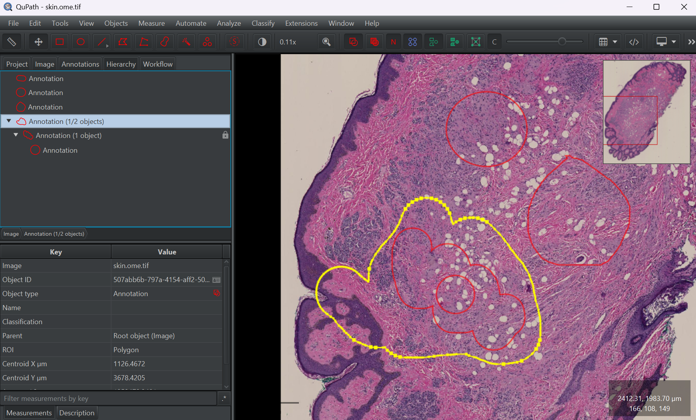
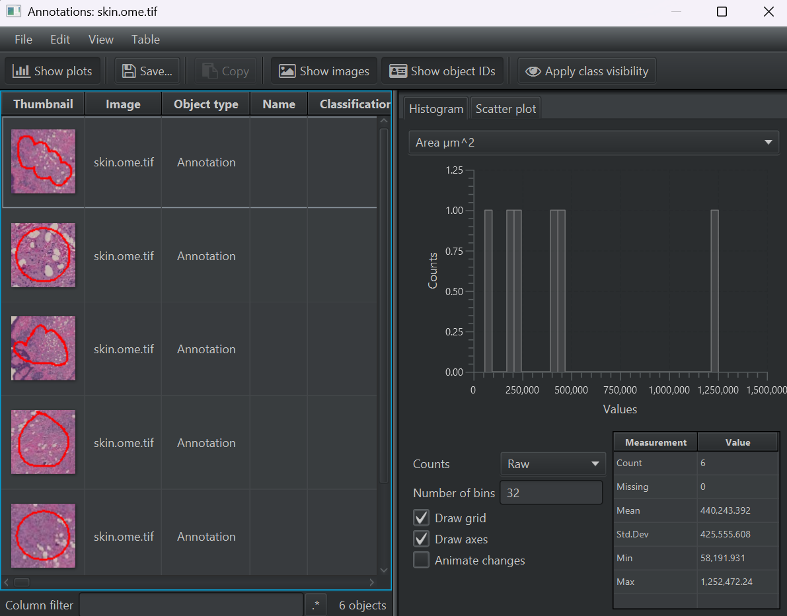

# Lesson: QuPath Basics - Annotations & Measurements

**Before running this lesson, read `README.md` in this folder for the setup instructions.**

**Duration:** About 30 minutes
**Goal:** Familiarize users with the QuPath interface, navigation, and manual annotation tools before moving to automated analysis.

## Instruction video

[Watch or download the video (MP4, 2:30)](videos/Day-1-Basic-Annotations.mp4) · [English captions (SRT)](videos/Day-1-Basic-Annotations.en.srt)

Compare the Brush and Wand on the same H&E skin patch. Extend a Brush annotation, correct the edge, and see the change in the QuPath measurement table.

- **0:23** — Draw an annotation with the **Brush**.
- **0:45** — Compare the **Wand** on the same patch.
- **1:13** — Extend the existing annotation.
- **1:39** — Correct the edge with **Alt + Brush**.
- **2:02** — Compare the areas in the measurement table.

## Part 1: Getting Oriented (5 Minutes)

*   In the **Image** tab, find the image dimensions and pixel size. A calibrated image can report areas in µm². Without a physical pixel size, work in px².
*   Open `View > Brightness/Contrast` (`Shift+C`) and toggle the H&E display channels. Hematoxylin emphasizes nuclei and eosin highlights other tissue components. These controls change the display. Choose the channel explicitly when measuring intensity.
*   Select the **Move** tool to pan by dragging. Scroll to zoom and use `View > Zoom > Zoom to fit` to return to the overview.

## Part 2: Interface Overview (3 Minutes)

*   **Project** lists the images. **Annotations** lists the regions you draw and their classes. **Hierarchy** shows how objects are nested.
*   An annotation defines a region of interest (ROI) you can draw or edit. A detection usually comes from a tool such as Cell detection. A region can be the parent of the cells detected inside it. Inspect an example in the **Hierarchy** tab.

## Part 3: Annotation Tools (10 Minutes)
*   **Shapes:**
    *   Select the **Rectangle Tool** (`R`) and draw a box.
    *   Select the **Ellipse Tool** (`O`) and draw a circle.
    *   Select the **Polygon Tool** (`P`) and click points to trace a shape. Double-click to close it.
*   **The Brush Tool:**
    *   Select the **Brush Tool** (`B`).
    *   Paint a region.
    *   **Tip:** Hold `Alt` while painting to erase.
    *   **Tip:** Select an existing annotation and hold `Shift` while brushing to continue adding to it.
*   **The Wand Tool:**
    *   Select the **Wand Tool** (`W`).
    *   Click on a high-contrast area (like the dark purple epidermis in the skin image).
    *   Hold `Shift` to add to the current Wand selection if it already picked a region.
    *   Try at two zoom levels and compare which pixels the Wand includes. Refine the outline with the Brush if needed.

## Part 4: Working with Annotations (5 Minutes)

*   Draw two overlapping shapes and select both in the **Annotations** list. Use `Objects > Annotations > Merge selected` to combine them.
*   Try **Duplicate selected annotations** before editing a shape. In the same menu, **Expand annotations** adjusts its boundary and **Fill holes** includes enclosed gaps. Compare the area before and after your edit.
*   Use `Objects > Annotations > Create full image annotation` to make a region covering the entire image. If you later run `02_report_basics.groovy`, remove the full-image reference annotation first to report just your practice shapes. The script sums all annotations on the open image.

## Part 5: Measurements (5 Minutes)

*   Open `Measure > Show annotation measurements`. Each row represents one annotation. Select a row to match the area and perimeter to the outline in the viewer.
*   With an annotation selected, try `Analyze > Calculate features > Add intensity features`. Pick a channel or stain and a statistic such as mean. **Preferred pixel size** controls sampling: a larger value processes a coarser version of the image. Use `Analyze > Calculate features > Add shape features` for additional shape measurements.
*   Use **Save** in the measurement table to export its values. For multiple project images, use `Measure > Export measurements`. To share the outlines themselves, use `File > Export objects as GeoJSON`.

## Part 6: Saving (2 Minutes)

Use `File > Save` (`Ctrl+S`) to write the current image's objects and measurements to the project. Reopen the image from the **Project** tab and check that your annotations are still present. Save any script edits separately in the Script Editor.
