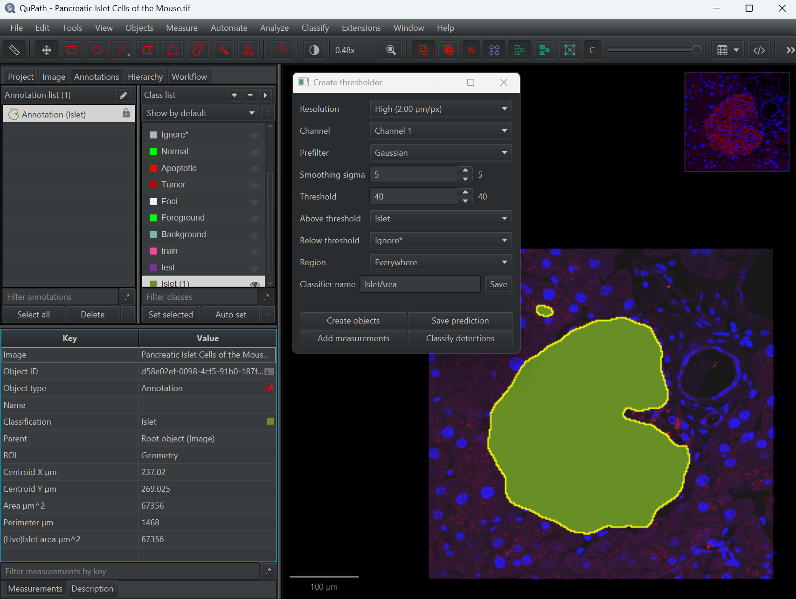

# Lesson: Threshold Classification

**Before running this lesson, read `README.md` in this folder for the setup instructions.**

**Duration:** 15-20 Minutes
**Goal:** Teach how to segment objects based on pixel intensity using the "Create Thresholder" tool.

## Part 1: The Concept (5 Minutes)
*   **Question:** "How do we find the bright object in this dark image?"
*   **Concept:** Here the object is simply *brighter* than the background. We can use a simple cutoff value (Threshold) based on intensity, without needing complex machine learning.

## Part 2: The Setup (2 Minutes)
*   **Action:** Run `01_setup_threshold.groovy`.
*   **Check:** The **Annotations** class list now includes **Islet**. This is the label you will assign to pixels above the threshold.
*   **QuPath classes:** Classes are named labels (with colors) that tell QuPath what each object represents—crucial for measurement tables, training classifiers, and keeping your hierarchy organized.
*   **Optional manual setup:** Use the **+** button in the **Annotations** class list to add `Islet` if you skipped the setup script.

## Part 3: Interactive Thresholding (10 Minutes)
*   **Step 1: Open the Tool**
    *   Go to `Classify > Pixel classification > Create thresholder`.
*   **Step 2: Adjust Parameters**
    *   **Resolution:** Controls the processing resolution. 'Extremely low' is fast for previewing, but you may want higher resolution for the final result.
    *   **Channel:** Select the channel containing the signal (**Channel 1**, the red islet signal in this image).
    *   **Prefilter & Smoothing:** Use 'Gaussian' and adjust 'Smoothing sigma' to reduce noise if needed.
    *   **Threshold:** Adjust the numeric value to define the cutoff. Pixels brighter than this value will be selected.
    *   **Above threshold:** Select the class to assign to bright pixels (e.g., **Islet**).
    *   **Region:** Set to 'Everywhere' to process the whole image.
* **Step 3: Save the Classifier**
    * Give it a descriptive name such as `Islet_Threshold` and click **Save**. Use `Classify > Pixel classification > Load pixel classifier` to reload it later.
* **Step 4: Convert the Prediction to Annotations**
    * Click **Create objects** in the thresholder dialog. When asked where to create them, choose **Full image** for this exercise or **Current selection** if you selected a parent annotation. The **Region** setting controls where the preview is shown.
    * Choose **Annotation**, set **Minimum object size** to about 100 µm² as a starting point, and confirm. **Split objects** creates one annotation per disconnected region. Touching regions remain connected unless the threshold or subsequent editing separates them.
    * Leave **Delete existing objects** off for the first run. When repeating the exercise, remove or replace the earlier result to avoid counting it twice.
    * If you only need area or area fraction within an existing region, use **Add measurements**. This records class measurements on the analysis region. The report in Part 4 requires the **Islet** annotations created by **Create objects**. [QuPath guide to measuring areas](https://qupath.readthedocs.io/en/stable/docs/tutorials/measuring_areas.html)

## Part 4: Getting The Result with a Script (3 Minutes)

* **Action:** Run `02_report_threshold.groovy`.
* **Outcome:** The script reports the summed area of all **Islet** annotations on the current image. Check a few outlines against Channel 1 and record the threshold, resolution, and area.
* **Discussion:** Thresholding is fast and accurate for high-contrast fluorescence, but fails if the background is uneven or the object has complex texture.
