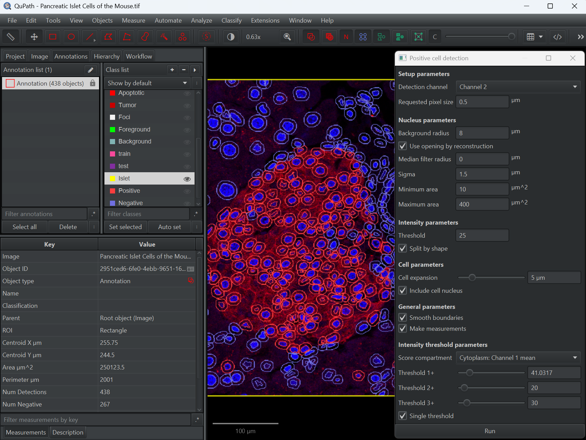
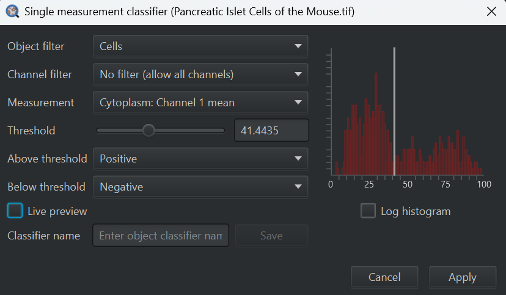

# Lesson: Positive Cell Detection

**Before running this lesson, read `README.md` in this folder for the setup instructions.**

**Duration:** About 25 minutes
**Goal:** Teach how to detect cells and classify them as Positive/Negative based on intensity in a single step.

## Instruction video

https://github.com/user-attachments/assets/95fd3811-4dbc-40b4-b748-bdec77a31ccf

[Download the subtitled MP4 (2:56)](videos/Day-1-Positive-Cell-Detection.mp4?raw=true) · [English captions (SRT)](videos/Day-1-Positive-Cell-Detection.en.srt)

Toggle the nucleus and insulin channels on the course image. Then change one threshold at a time in the same test region to see which outlines disappear and which cells change class.

- **0:26** — Switch between the nuclear and insulin channels.
- **0:59** — Choose the detection channel and score compartment.
- **1:31** — Change the nucleus detection **Threshold**.
- **2:03** — Change the positivity cutoff **Threshold 1+**.
- **2:30** — Review the overlays and report the positive fraction.

## Part 1: The Concept (5 Minutes)
*   **Scenario:** Estimate the fraction of detected cells with red insulin staining above a chosen threshold in this image.

## Part 2: The Setup (2 Minutes)
*   **Action:** Run `01_setup_positive.groovy`.
*   **Explain:** "I've created our buckets: **Positive** (Red) and **Negative** (Blue)."

*   **Before running detection:** Positive cell detection acts only inside the currently selected annotation. Select an existing ROI or create one so the tool knows where to work.
    *   For small demo images, use `Objects > Annotations > Create full image annotation` (shortcut **Ctrl+Shift+A**) to wrap the entire field of view instantly.
    *   Select the annotation. Start with a small test region while tuning the parameters.

## Part 3: Running the Tool (10 Minutes)
*   **Step 1: Open the Tool**
    *   `Analyze > Cell detection > Positive cell detection`.
* **Step 2: Configure Detection**
    * **Detection channel:** Pick the fluorescence channel containing nuclei (Channel 2 in this dataset).
    * **Requested pixel size:** 0.5 µm keeps the detection smooth without being too slow.
    * **Background radius / Median filter / Sigma:** These smooth the image before nucleus finding. Use the screenshot values (8, 0, 1.5) and explain that larger radii remove more low-frequency background while sigma controls Gaussian blur.
    * **Minimum/Maximum area:** Filters detections outside 10–400 µm² so debris or merged clumps are ignored.
    * **Split by shape:** Leave checked so elongated clusters can be separated into individual cells.
* **Step 3: Tune Intensity & Cell Parameters**
    * **Threshold (Intensity parameters):** Defines which nuclei are initially accepted. Start around 25 for Channel 2. Click **Run**, then check whether both dim and bright nuclei have outlines before tuning the threshold.
    * **Cell expansion:** Start with 5 µm to estimate the cell boundary around each nucleus. Keep **Include cell nucleus** and **Make measurements** enabled so you can inspect nuclear and cytoplasmic values.
    * **Smooth boundaries** smooths the outline used for measurements. Compare the result with the original signal around touching nuclei.
    * **Score compartment:** Choose where the positivity is measured (e.g., `Cytoplasm: Channel 1 mean`).
    * **Threshold 1+/2+/3+:** These sliders define the intensity bins for the score compartment. With **Single threshold** enabled, only `Threshold 1+` is used and everything above it is marked **Positive**—perfect for a binary Positive/Negative lesson.
* **Step 4: Run**
    * Enable **Single threshold**, then click **Run**. **Threshold** in the detection section controls which nuclei are found. **Threshold 1+** in the scoring section controls which of those cells are labelled positive. Check the outlines and labels against both channels before running on the full analysis region.
*   **Note on object type:** Cell Detection creates the special **Cell** object type—essentially a paired nucleus ROI with an optional expanded cytoplasm ROI—so QuPath can store both nuclear and cellular measurements together (see the [object types overview](https://qupath.readthedocs.io/en/stable/docs/concepts/objects.html#types-of-object)).     

## Part 4: Alternative – Detect, Then Classify (5 Minutes)
*   Use the same ROI, detection settings, and scoring measurement to compare this workflow with Part 3. Run it on a separate image entry or remove the earlier detections before starting so each cell is counted once.
*   **Step 1 – Detect cells:**
    *   Run `Analyze > Cell detection > Cell detection` with the detection parameters from Part 3.
    *   Click **Run** to add nuclei/cell objects to the hierarchy. 
*   **Step 2 – Build a single measurement classifier:**
    *   Choose `Classify > Object classification > Single measurement classifier...`.
    *   In the dialog (second screenshot), set **Object filter = Cells**, **Measurement = Cytoplasm: Channel 1 mean**, adjust the **Threshold** slider, and assign **Above threshold = Positive**, **Below threshold = Negative**.
    *   Optionally type a descriptive **Classifier name** and click **Save** so you can reapply it later or batch-process via `Classify > Object classification > Load object classifier`.
*   **Result:** Click **Apply** to instantly recolor every detected cell as Positive/Negative—the same outcome as Part 3, but now driven by reproducible measurements.

## Part 5: Getting The Result with a Script (3 Minutes)
*   **Action:** Run `02_report_positive.groovy`.
*   **Outcome:** The report uses `Positive ÷ (Positive + Negative) × 100` for labelled detections on the current image. It excludes unlabelled objects. Record both counts, the score compartment, and the threshold so you can reproduce your percentage.
*   **Discussion:** Apply the same scoring rule when comparing comparable images. Check how the percentage changes if you change the score compartment or threshold.
