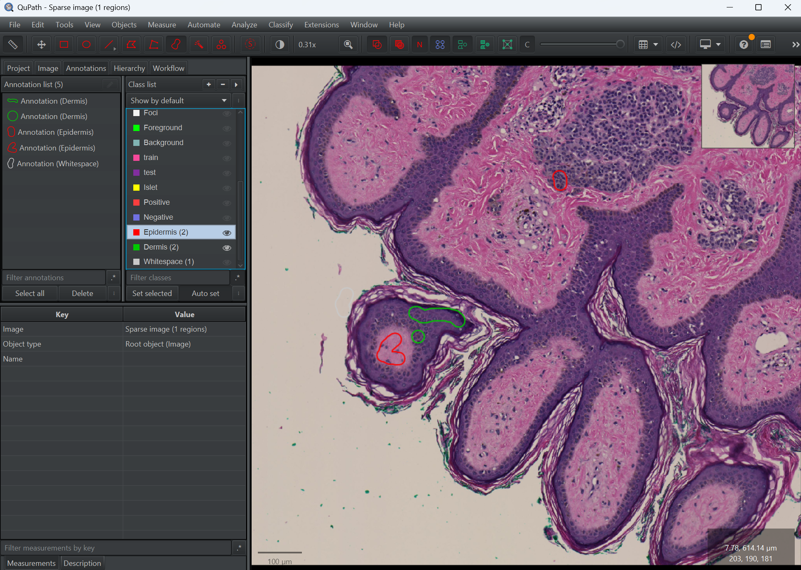
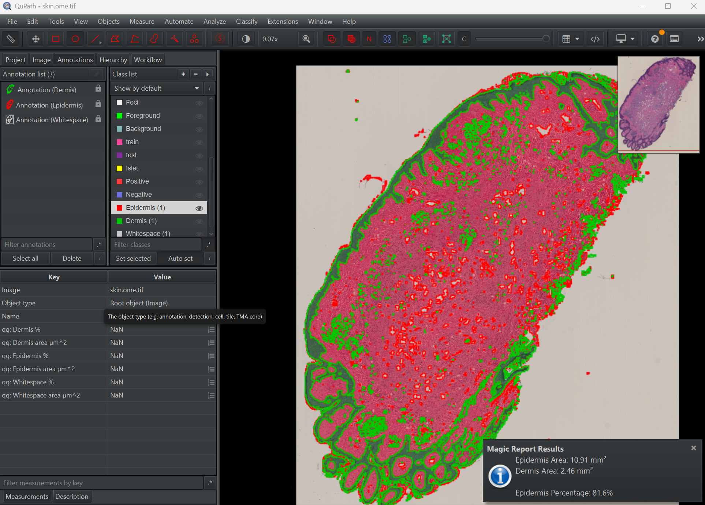

# Lesson: Pixel Classification in QuPath

**Before you start, read `README.md` in this folder for the setup instructions.**

**Duration:** 30-60 Minutes
**Goal:** Experience "Training by Example" using the Random Trees pixel classifier.

## Instruction video

https://github.com/user-attachments/assets/bb68dd70-ff32-4647-bc2a-2bccb50651d4

[Download the subtitled MP4 (3:49)](videos/Day-2-Pixel-Classification.mp4?raw=true) · [English captions (SRT)](videos/Day-2-Pixel-Classification.en.srt)

The video starts with a three-class warm-up using Epidermis, Dermis, and Whitespace. It shows how to paint training examples, refine the live prediction, and turn predictions into measurable annotations. For the full exercise, use the class list in Part 2.

- **0:51** — Choose a class and enable **Auto set**.
- **1:11** — Use the **Brush** to paint small sample regions.
- **2:07** — Compare the first and refined predictions.
- **2:34** — Use **Create objects** to convert the prediction into annotations.

## Part 1: The "Why" (5 Minutes)
*   **Guiding question:** Why can't we just select the purple stuff?
*   **Activity:**
    1.  Open `skin.ome.tif`.
    2.  Zoom into the dark purple edge (epidermis).
    3.  Describe the epidermis color (deep purple) and texture in your own words.
    4.  Move into the dermis and describe its pink tone and smoother texture.
    5.  **Takeaway:** When two layers have similar colours, texture features can help tell them apart.

## Part 2: Prepare the Classes and Training Image (5 Minutes)

Run `assignment1_magic_setup.groovy` on the original `skin.ome.tif` before drawing anything. It clears old annotations and adds six tissue classes plus **Whitespace**. EPTZ is the epidermal phase transition zone identified in this course's skin example, between the stratum corneum and stratum granulosum.

You can train directly on the original image or follow these steps to make a smaller training composite.

1. Open `Classify > Training images > Create region annotations`. Give the crop rectangles a common class such as `Region*` and place them over representative areas containing epidermis, dermis, and blank glass. Save the image data with `Ctrl+S`.
2. Open `Classify > Training images > Create training image`, select the crop class, leave **Preferred image width** at its default for the first attempt, and click **OK**.
3. Open the new training image from the **Project** tab. Label the tissue layers there in Part 3, then apply your saved classifier to the original in Part 5.

## Part 3: Interactive Training (15 Minutes)
*   **Step 1: Annotate**
    *   Toggle **Auto Set** on and work from the surface inward: **Stratum corneum → EPTZ → Stratum granulosum → Stratum spinosum → Stratum basale → Dermis**.
    *   Use the **Brush** to draw several small, non-overlapping examples per class. Stay inside clear boundaries first, then add examples with different shades and textures. Check the class on each stroke in the **Annotations** tab.
    *   Finish with a quick pass on **Whitespace** for the empty glass background.
*   **Step 2: Train**
    *   Open `Classify > Pixel classification > Train pixel classifier` (see the [Pixel classification tutorial](https://qupath.readthedocs.io/en/stable/docs/tutorials/pixel_classification.html)).
    *   When the dialog appears:
        *   **Classifier:** Choose *Random trees (RTrees)*—it is fast, forgiving, and ideal for a first classifier.
        *   **Resolution:** Start at *Moderate* (3.65 µm/px). A larger µm/px value is a coarser resolution and usually runs faster. Finer resolution can preserve thin layers at the cost of processing time.
        *   **Features:** Leave *Default multiscale features 2D* enabled so the classifier can mix Gaussian blur, Laplacian, and structure tensor cues.
        *   **Output:** Choose *Classification* to assign one class per pixel. A probability output provides a separate score for each class when supported. These scores are estimates and can help identify uncertain regions.
        *   **Region:** Use *Everywhere* for a whole-view preview or *Any annotation ROI* to limit the overlay. Your labelled examples supply the training pixels.
        *   **Classifier name:** Enter a descriptive name such as `SkinLayers_RT`. Save the classifier once you are satisfied with the preview.
    *   **Crucial step:** Click **Live prediction** so the viewer updates instantly each time you add or correct strokes.
*   **Step 3: Refine (Human-in-the-loop)**
    *   Watch for mistakes (for example, QuPath may think an ink mark is dermis).
    *   Select the correct class, label a small representative example of the correct tissue, and let **Live prediction** refresh.
    *   Continue looping between annotate → train → check until the overlay looks right.

## Part 4: Under the Hood (10 Minutes)
*   **Purpose:** See how parameter choices influence quality and speed.
*   **Try this:**
    *   Change **Resolution** to *Low*. Notice how the overlay gets blocky but refreshes quickly.
    *   Change **Resolution** to *High*. Notice the finer detail, extra noise, and slower refresh.
    *   Open **Select features…** in the training dialog and explore how the components work (see the [QuPath pixel-classification tutorial](https://qupath.readthedocs.io/en/stable/docs/tutorials/pixel_classification.html#select-features) for visuals):
        *   **Channels:** Choose which stains feed the classifier. Using all channels helps when texture differences hide in non-RGB spaces.
        *   **Scales:** Smaller scales (e.g., 0.5) emphasize fine detail, while larger scales (e.g., 2.0) smooth over noise to capture broad tissue trends.
        *   **Features:** Each feature type (Gaussian blur, Laplacian of Gaussian, structure tensor, etc.) highlights different patterns—edges, blobs, gradients—so the classifier sees more than raw intensity.
        *   **Local normalization:** Setting a radius (like 8 px) forces QuPath to compare each pixel to its neighborhood, which can tame illumination variation before features are computed.
    *   Toggle feature combinations and scales, retrain, and observe how the classification overlay changes. This helps you build intuition for which settings capture epidermis vs dermis texture.

## Part 5: Apply to the Whole Slide (5 Minutes)
*   Save the classifier. Open the original `skin.ome.tif` if you trained on the composite. If you trained on the original, save or export the training annotations separately, then remove the labelled strokes and earlier result annotations from the reporting image. The script sums any annotations carrying the six tissue classes.
*   Choose `Classify > Pixel classification > Load pixel classifier` and select the saved classifier. Check the prediction in an area you did not label. With **Create objects** in the classifier dialog, choose **Full image** or **Current selection** if you selected an analysis annotation. Use **Annotation** as the new object type. Leave **Split objects** off if you want disconnected patches of each class grouped together.
*   Save your new prediction annotations in the project.

## Part 6: The Result (5 Minutes)

*   Run `assignment1_magic_report.groovy` after **Create objects**. Its percentage uses the summed area of the six tissue classes as the denominator. **Whitespace** is excluded.
*   Record the classifier name, resolution, analysis region, and area and percentage for each layer. Compare the outlines with the image and describe one region where the predicted boundary is uncertain.

