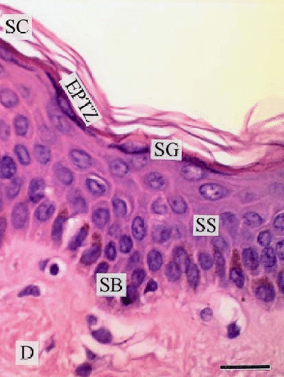

# Day 2 Assignments: Machine Learning Classification

These exercises reinforce the Pixel Classification and Cell Classification lessons. Use a working project for the exercises and save each image after analysis. See the [course setup steps](../../README.md#before-each-lesson).

## Assignment 1 – Stratified Skin Pixel Classification
1. Open `resources/skin.ome.tif` and run `scripts/assignment1_magic_setup.groovy` if needed.
2. Use the **Pixel classifier** tool to label all six epidermal/dermal compartments created by the setup script: **Stratum corneum, EPTZ, Stratum granulosum, Stratum spinosum, Stratum basale, Dermis** (keep **Whitespace** for glass/background).
3. Train on small representative regions. Use **Live prediction** to refine examples where the classifier confuses adjacent layers, then check an area with no training strokes.
4. Save the classifier and record how it performs on the full image.
5. Use **Create objects** to produce annotations in the analysis region before running `scripts/assignment1_magic_report.groovy`. Keep training strokes and earlier results off the reporting image so they are excluded from the six-class tissue area totals.
6. **Deliverable:** Screenshot of the multi-class overlay, the text output from `assignment1_magic_report.groovy`, and a short note on which layers were hardest to separate (and why).

<em>H&E staining of human skin reveals the epidermis and partial dermis. All cellular components can be visualized with the H&E stain: stratum corneum (SC); the epidermal phase transition zone (EPTZ) (~42 µm); stratum granulosum (SG); stratum spinosum (SS); stratum basale (SB); and the dermis (D). Scale bar 30 µm.</em>

## Assignment 2 – EM Organelle Pixel Classification
1. Open `resources/Cell(EM).ome.tif`, a single-channel electron microscopy image. Start with a small ROI where you can identify the structures confidently.
2. Use the **Pixel classifier** to segment different cellular compartments based on their texture and intensity patterns.
3. Create classes for the main structures visible: **Mitochondria** (dark oval structures with internal cristae), **Cytoplasm**, **Vesicles**, and **Membrane** (or choose your own relevant structures).
4. Train using intensity and texture features. Start with a resolution fine enough to preserve the structures you labelled. Check an unlabelled part of the ROI before applying the classifier.
5. Use **Add measurements** on the selected ROI to measure class areas, or use **Create objects** to inspect the contours. State which area you used as the denominator for the fractions.
6. **Deliverable:** Screenshot of the pixel classifier overlay, a table showing the area/percentage of each segmented structure, and a short note on which structures were easiest vs. hardest to classify.

## Assignment 3 – Dividing Cell Identification in `CellsNuclei.ome.tif`
1. Open `resources/CellsNuclei.ome.tif` (red nuclei, green membranes similar to the preview image) and run `scripts/assignment3_magic_setup.groovy` to load the **Dividing** and **Non-dividing** classes.
2. Draw and select a parent annotation. Run `Analyze > Cell detection > Cell detection` using **Channel 1** for nuclei and enable **Make measurements**. Inspect **Channel 2** for the membrane signal.
3. Label at least 15 examples of each class using either the **Points** or **Unlocked annotations** workflow, then train an **Object classifier** (Random Trees) using available measurements from both channels. Compare nucleus shape and intensity with Channel 2 measurements in the expanded cell region. Use **Live update** to inspect predictions, then check cells outside your training examples.
4. Apply the object classifier to the existing cells, then run `scripts/assignment3_magic_report.groovy`. It reports the counts and percentages among detections labelled **Dividing** or **Non-dividing**.
5. On a separate copy or after saving the first report, use a **Single measurement classifier** from Day 1 with one feature and the same two classes. Compare the two percentages on the same cells. Note which examples a one-feature cutoff misses.
6. **Deliverable:** Screenshot of the classifier overlay, the text output from `assignment3_magic_report.groovy`, and a short paragraph summarizing the % dividing cells from both methods and explaining any discrepancies.

## Bonus Assignment – Your Own Day 2 Experiment
* **Image:** Pick any image from the main `resources/` folder.
* **Objective:** Design a mini-analysis that combines at least one of the two Day 2 tools (pixel classifier, cell detection + object classifier, feature selection, measurement export, etc.). Decide on a machine-learning-friendly biological question (layer proportions, phenotype ratios, intensity comparisons).
	1. Briefly describe why you selected the image and what you plan to measure.
	2. Run the necessary Day 2 steps (e.g., create training annotations, train/validate a classifier, generate measurements, export reports).
	3. Summarize the result in a short paragraph plus a screenshot or chart.
* **Deliverable:** Turn in a one-slide summary or short paragraph detailing the question, the Day 2 tools you used, key parameter values (resolution, feature set, classifier type), and the final measurement. Include at least one screenshot showing the classifier or report in action.

> **Tip:** Treat this as a self-guided experiment. Pixel classification, object classification, feature engineering, and reporting scripts to answer a question that would be tedious with manual tools alone.

