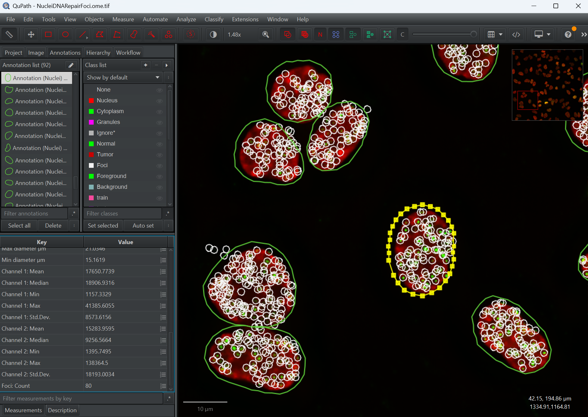

# Lesson: Spot Detection with Spotiflow

**Before running this lesson, read `README.md` in this folder for the setup instructions.**

**Duration:** 30 Minutes
**Goal:** Detect DNA repair foci within nuclei using a pre-trained deep learning spot detector.

## Part 1: The Context (5 Minutes)
*   **Image:** `NucleiDNARepairFoci.ome.tif`.
    *   **Red Channel (DAPI):** Nuclei.
    *   **Green Channel (GFP):** DNA Repair Foci (Spots).
    *   QuPath may display these as **Channel 1** and **Channel 2**, respectively.
*   **Goal:** Count the number of spots *per nucleus*.

## Part 2: Parent Detection with StarDist (5 Minutes)
*   **Concept:** Detect nuclei first so each focus can be counted within a nucleus outline.
*   **Action:** Draw and select a representative parent annotation, then run `01_detect_nuclei.groovy`. Use **Channel 1** for the nuclei.
*   **Parameters:**
    *   **Channel:** Select the DAPI/nucleus channel.
    *   **Downscale:** Resolution factor (1 = full resolution).
    *   **Probability Threshold:** Detection confidence (0.5 is a good default).
    *   **Mean/Gaussian filter:** Optional preprocessing for noisy images.
    *   **Exclude on borders:** Remove nuclei touching image edges.
*   **Result:** Annotations classified as **Nuclei**. Check several outlines against the red signal. These annotations define the patches processed in Part 3.

## Part 3: Spotiflow Foci Detection (10 Minutes)
*   **Concept:** Spotiflow is a deep learning model trained specifically for spot detection. The script exports a patch around each nucleus and sends it to Spotiflow. The outline then defines where the spots are counted.
*   **Action:** Run `02_spotiflow_foci.groovy` after StarDist has created **Nuclei** annotations. It uses all annotations with that class on the open image.
*   **Parameters:**
    *   **Foci channel:** Select **Channel 2**, the green signal containing the spots.
    *   **Foci class name:** Classification label for detected foci (default: "Foci").
    *   **Spotiflow device:** Computation device (`auto`, `cuda`, `cpu`, `mps`).
    *   **Pretrained model:** Choose from available models:
        *   `general` - General purpose spot detection (recommended default).
        *   `hybiss` - Optimized for HybISS data.
        *   `synth_complex` - Trained on complex synthetic data.
        *   `fluo_live` - For live-cell fluorescence imaging.
        *   This exercise uses 2D patches. Keep `general` as your starting point.
    *   **Probability threshold:** Leave blank for model defaults, or set a value (0-1) to filter weak detections.
    *   **Peak detection mode:** `fast` is the default. Use `skimage` if you want to compare how the two peak finders handle close spots.
*   **Result:** Point detections are created for each detected focus.
*   **Check:** Enable `View > Show detections` and zoom in on a few nuclei. The foci are point detections in the **Hierarchy** tab. In `Measure > Show annotation measurements`, find **Foci: Count** on the nucleus rows. Compare the points against the green signal.

## Part 4: Combined Workflow (10 Minutes)
*   **Concept:** For convenience, you can run both StarDist nuclei detection and Spotiflow foci detection in a single script with one unified parameter dialog.
*   **Action:** Use a separate image entry if you want to keep the two-step result. Run `03_stardist_spotiflow_combined.groovy`. It replaces the existing **Nuclei** annotations and foci of the selected class on the current image.
*   **Advantage:** 
    *   Single dialog with all parameters for both methods.
    *   Automatically handles the full workflow: detect nuclei → detect foci → count foci per nucleus.
    *   Select the same parent ROI to compare with Parts 2–3. With no selection, the script creates a full-image annotation.
*   **Parameters:** Combines all parameters from scripts 01 and 02:
    *   **StarDist section:** Nucleus channel, downscale, threshold, filters, border exclusion.
    *   **Spotiflow section:** Foci channel, class name, device, model, probability threshold, peak mode.
*   **Result:** 
    *   Nucleus annotations with shape and intensity measurements.
    *   Foci point detections as children of each nucleus.
    *   "Foci: Count (nucleus)" measurement added to each nucleus annotation.
*   **Visualization Note:** Zoom in to see the point detections and check that the counts on selected nucleus rows match the image.

## Part 5: Histogram Report (5 Minutes)
*   **Concept:** Visualize the distribution of foci counts across all nuclei to understand the population statistics.
*   **Action:** Run `04_report_foci_histogram.groovy`.
*   **Output:**
    *   A histogram of nuclei by foci count. Bin size **1** gives one bar per count. The default **8** groups counts into ranges such as 0–7 and 8–15.
    *   **Summary statistics:** Mean, median, min, max, and standard deviation of foci per nucleus.
    *   Results are printed to the log and displayed in a popup chart window.
*   **Interpretation:** Report the number of nuclei, the median, and the bin size. Check examples from low and high bins for segmentation errors or noisy detections. To compare samples, use consistent acquisition and detection settings, compare equivalent regions, and keep biological replicates separate.
