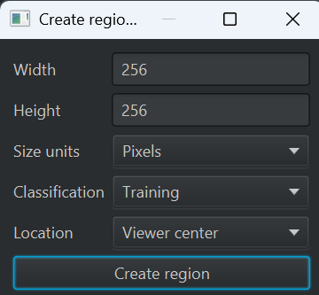

# Lesson: Training a Custom Cellpose Model on Phase-Contrast Images

**Before running this lesson, read `README.md` in this folder for the setup instructions.**

**Duration:** About 60 minutes of exercises, with additional training time depending on the hardware and settings
**Goal:** Go from raw images to a custom-trained Deep Learning model.

## Instruction video

https://github.com/user-attachments/assets/c86f52b7-9690-45be-b4cb-d9d060677b0f

[Download the subtitled MP4 (3:34)](videos/Day-3-Cellpose-Training.mp4?raw=true) · [English captions (SRT)](videos/Day-3-Cellpose-Training.en.srt)

Use the phase-contrast course images to set up a training region, label individual targets, check the object hierarchy, and run a custom model on held-out image `21.jpg`. The illustrated nucleolus labels are an example for practicing the workflow. Review each target and outline in your own training regions.

- **0:54** — Create a 256 × 256 pixel **Training** rectangle.
- **1:23** — Outline the individual nucleoli.
- **1:57** — Verify the parent and child objects in **Hierarchy**.
- **2:19** — Train the model and check the log.
- **2:56** — Compare a real prediction with the held-out image.

## Part 1: Project Setup & Image Calibration (5 Minutes)

Create the project and add the 30 images as described in the [setup instructions](README.md). Run `01_calibrate_images.groovy` once. Enter **0.2 µm/pixel** for these teaching images, then reopen the current image and verify the pixel size in the **Image** tab. Calibration lets QuPath convert model diameters and measurements between pixels and micrometres.

Choose the image split before annotating. For example, use `01.jpg`–`14.jpg` for training, `15.jpg`–`20.jpg` for validation, and `21.jpg`–`30.jpg` for testing. Keep each image in only one split. The test images can stay in the project without Training or Validation regions.

## Part 2: The Challenge (5 Minutes)
*   **Activity:** Open `01.jpg` (Phase Contrast).
*   Draw and select a representative annotation. Run `02a_test_cellpose.groovy` with one local model, such as `cyto3`. Save a screenshot and remove the baseline detections before running `02b_test_stardist.groovy` on the same region. Use the default StarDist model and the only available image channel.
*   **Observation:** Check which objects each model misses or splits and whether the outlines follow the visible boundaries. Performance can differ by target and model.
*   **The Problem:** Pre-trained deep learning models work best on data similar to their training set. Phase contrast microscopy has unique optical properties that confuse models trained on fluorescence or brightfield images.
*   **Next step:** Create training labels for one consistent target, such as nuclei or nucleoli.

## Part 3: Creating Ground Truth (20 Minutes)

> **📖 Reference:** For more details on training custom Cellpose models, see the [BIOP Cellpose Extension documentation](https://github.com/BIOP/qupath-extension-cellpose?tab=readme-ov-file#training-custom-models).

*   **Goal:** Create a high-quality dataset with separate Training and Validation sets.
*   **The Concept:**
    *   **Training regions:** Cellpose adjusts its weights using the annotated objects in these regions.
    *   **Validation regions:** Cellpose monitors performance on these regions during training. Reserve the test images for the final comparison.

> **Dense annotations:** Outline every instance of the target inside each Training and Validation rectangle. Unlabelled objects are treated as background.

*   **Requirements:**
    *   **Training Regions:** Aim for **16** densely annotated training rectangles. The script accepts a minimum of **6**.
    *   **Validation Regions:** Aim for **6** densely annotated validation rectangles. The script accepts a minimum of **2**.
    *   **Consistent Size:** All training/validation regions should be the **same size** (e.g., 256×256 pixels).
    *   **Distribution:** Distribute rectangles over several images in each split. Keep them inside the image bounds and avoid overlapping rectangles.

  

*   **Action:**
    1.  **Define Classes:** Run `03_setup_classes.groovy` to add the **Training** and **Validation** classes.
    2.  **Create Region:** Go to `Classify > Training images > Create region annotations`.
        *   Set **Width** and **Height** to the same value (e.g., `256` pixels).
        *   Set **Size units** to `Pixels`.
        *   Set **Classification** to `Training` or `Validation`.
        *   Set **Location** to `Viewer center` to place the region at your current view.
        *   Click **Create region** to add the annotation.
        
        > 💡 **Tip:** Using the "Create region annotations" dialog ensures all your training regions are exactly the same size, which helps with consistent training.
        
    3.  **Annotate Objects:**
        *   Turn off **Auto set** before outlining individual objects with the **Wand** or **Brush**. The outer rectangle carries the **Training** or **Validation** class. The object outlines inside it can remain unclassified.
        *   Give each instance a separate outline. Verify that each rectangle contains object outlines in the **Hierarchy** tab.
    4.  **Repeat:** Continue across images in each split until you reach the planned number of regions. Save the annotations as you go.

## Part 4: Training (15 Minutes)
*   **Action:** Save the annotations on the current image, then run `04_train_cellpose.groovy`. The script reads the saved project annotations.
*   **Important Parameters:**
    *   **Base model:** Select `None (train from scratch)` for the baseline. The transfer-learning assignment compares this with starting from pretrained weights.
    *   **Epochs:** Use **75** as a starting point for the full exercise. An epoch is one pass through the training set. Longer training takes more time and may overfit. Review the validation loss when comparing runs.
    *   **Diameter:** Set the average diameter of your objects in µm. Measure a few typical objects to estimate this value.
    
    > 💡 **Tip:** Draw a line across several typical objects and read the length in the annotation measurement table. Use a representative diameter in µm.
    
*   **What happens:**
    *   QuPath exports your images and annotations.
    *   Cellpose trains a new model to minimize the error between its guess and your drawing.
    *   The model file is saved under `models/` in the project. Check the training log and look in `models/QC/` for the training results and validation report.

## Part 5: Inference (10 Minutes)
*   Open a held-out image such as `21.jpg`. Draw and select a parent annotation, then run `05_run_custom_cellpose_model.groovy` and select your saved model.
*   Compare it with a pretrained model on the same test region. Save each result separately or take a screenshot and clear the previous detections before switching models. Record missed objects, extra detections, and boundary errors.
